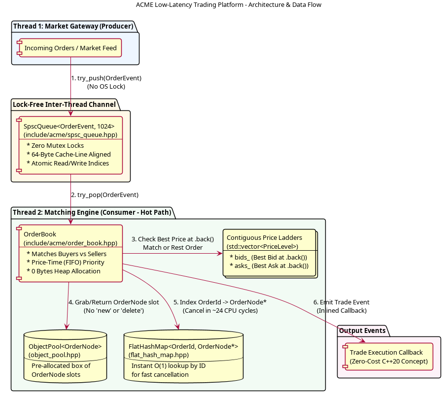
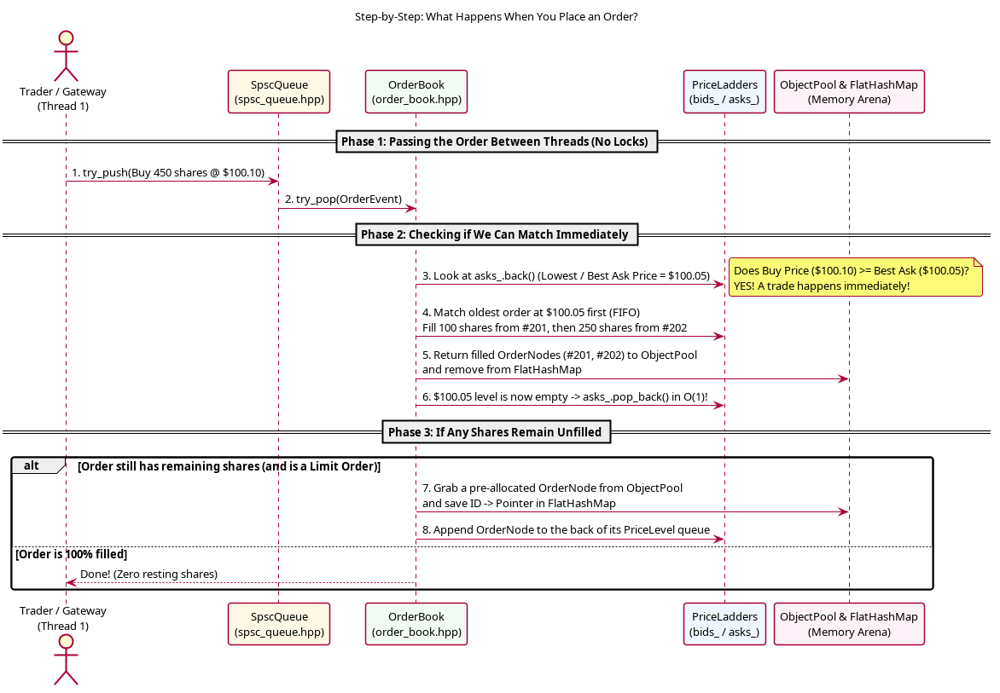
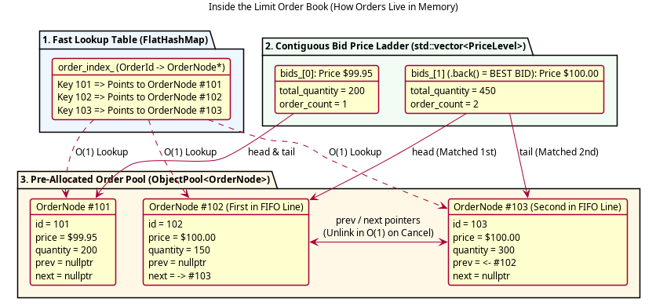

# Beginner's Guide to ACME Trading Platform (Plain-English Edition)

If the previous technical explanation felt like a wall of alien jargon (`FlatHashMap`, `intrusive linked list`, `alignas(64)`, `__rdtsc`), **don't worry—that is 100% normal when starting C++ for finance!**

This guide explains everything from the ground up in plain English, comparing what we do here to everyday languages like Python, Java, or JavaScript.

---

## 1. What Does This Program Actually Do?

Every stock exchange in the world (NASDAQ, NYSE, CME, Binance) runs a program at its core called a **Matching Engine** with a **Limit Order Book**.

Think of a **Limit Order Book** as two lines of people at a marketplace trading Apple stock:

1. **The Buyers Line ("Bids"):** People who want to **BUY**, sorted from the **highest price** down.
   * *Alice says: "I'll buy 150 shares for $100.00"*
   * *Bob arrives 1 second later and says: "I'll also buy 300 shares for $100.00"*
   * *Charlie says: "I'll buy 200 shares, but only if the price drops to $99.95"*
2. **The Sellers Line ("Asks"):** People who want to **SELL**, sorted from the **lowest price** up.
   * *Dave says: "I'll sell 100 shares for $100.05"*
   * *Eve arrives 1 second later and says: "I'll sell 250 shares for $100.05"*

Right now, nobody trades because the highest buyer ($100.00) is offering less than the lowest seller ($100.05). The 5-cent gap between them is called the **Spread**.

### How a Trade Happens (Price-Time Priority / FIFO)
Suddenly, **Frank** walks in and says: *"I want to BUY 450 shares, and I'm willing to pay up to $100.10!"*

The Matching Engine immediately matches Frank against the Sellers line using two fair rules (**Price-Time Priority**):
1. **Best Price First:** Match the cheapest sellers ($100.05) before more expensive sellers ($100.10).
2. **First-In, First-Out (FIFO) Time Priority:** At $100.05, Dave arrived before Eve, so Dave gets his 100 shares sold first, and then Eve gets her 250 shares sold!

---

## 2. Visual Overview of the Project

### Diagram 1: System Architecture & Data Flow

*(Source: [`docs/diagrams/architecture.puml`](diagrams/architecture.puml))*

### Diagram 2: Step-by-Step Order Matching Flow

*(Source: [`docs/diagrams/order_matching_flow.puml`](diagrams/order_matching_flow.puml))*

### Diagram 3: How Orders Are Stored Inside RAM

*(Source: [`docs/diagrams/memory_layout.puml`](diagrams/memory_layout.puml))*

---

## 3. Translating the "Scary" C++ Jargon into Plain English

Here is a cheat sheet translating every technical term from our codebase into simple concepts:

| Jargon Term | Where It Is Used | What It Means in Plain English |
| :--- | :--- | :--- |
| **Fixed-Point Price (`Price = int64_t`)** | [`include/acme/types.hpp`](../include/acme/types.hpp) | Computers are bad at decimal math (`0.1 + 0.2 = 0.30000000000000004`). So instead of storing `$100.05` as a `double`, we multiply by `10,000` and store it as the whole integer `1,000,500`. |
| **Heap Allocation (`new` / `malloc`)** | [`include/acme/object_pool.hpp`](../include/acme/object_pool.hpp) | In Python/Java, every time you create an object, your program asks the Operating System for a new piece of memory ("the heap"). Asking the OS is slow and unpredictable. |
| **`ObjectPool` (Pre-Allocated Arena)** | [`include/acme/object_pool.hpp`](../include/acme/object_pool.hpp) | Instead of asking the OS for memory every time an order arrives, we buy a giant box of 100,000 empty `OrderNode` slots when the program starts. When an order arrives, we grab a slot from the box in 1 nanosecond; when filled/canceled, we put the slot back. |
| **`FlatHashMap` vs `std::unordered_map`** | [`include/acme/flat_hash_map.hpp`](../include/acme/flat_hash_map.hpp) | A dictionary/map lets us look up an order by its ID (`#102`). C++'s built-in `std::unordered_map` scatters entries all over RAM using pointers. Our `FlatHashMap` stores everything in one flat, side-by-side array so the CPU can read it super fast. |
| **Contiguous Price Ladder (`.back()`)** | [`include/acme/order_book.hpp`](../include/acme/order_book.hpp) | Instead of storing price levels in a tree (`std::map`), we store them in a simple sorted list (`std::vector`) with the **Best Price at the very end (`.back()`)**. Why at the end? Because in a list, deleting the last item (`pop_back()`) is instant! |
| **Intrusive Doubly-Linked List** | [`include/acme/order_book.hpp`](../include/acme/order_book.hpp) | In trading, 95% of orders are canceled before they trade. If 500 people are standing in line at `$100.00` and person #250 cancels, how do they leave the line instantly? Each `OrderNode` holds a pointer to the person in front (`prev`) and behind (`next`) them. To leave the line, #249 and #251 just join hands (`O(1)` time!). |
| **`SpscQueue` (Lock-Free Ring Buffer)** | [`include/acme/spsc_queue.hpp`](../include/acme/spsc_queue.hpp) | When two threads share data, beginners use a `mutex` (a lock that puts one thread to sleep while the other works). Waking up a sleeping thread takes ~5,000 nanoseconds. A **Lock-Free Ring Buffer** is a circular conveyor belt where Thread 1 drops orders on one end and Thread 2 picks them up on the other end without ever locking or sleeping (~10 nanoseconds). |
| **Cache Line (`alignas(64)`) & False Sharing** | [`include/acme/spsc_queue.hpp`](../include/acme/spsc_queue.hpp) | Your CPU never reads just 1 byte from RAM—it always grabs a 64-byte chunk called a **Cache Line**. If Thread 1 and Thread 2 write to two different variables that accidentally sit inside the same 64-byte chunk, the two CPU cores fight over that chunk ("False Sharing"). Writing `alignas(64)` forces those variables onto separate 64-byte chunks! |
| **`__rdtsc` (CPU Cycle Counter)** | [`benchmarks/bench_order_book.cpp`](../benchmarks/bench_order_book.cpp) | Asking the Operating System "what time is it?" takes ~900 nanoseconds—which is slower than our order book (~67 nanoseconds)! `__rdtsc` reads the CPU's internal hardware stopwatch directly in ~3 nanoseconds. |

---

## 4. How to Read the Code Step-by-Step

If you are new to C++, don't try to read everything at once. Follow this 4-step path:

1. **Step 1 — Start with [`include/acme/types.hpp`](../include/acme/types.hpp) (65 lines)**
   * Very easy to read! Shows how we define `Price`, `Quantity`, `OrderId`, `Side` (`Buy`/`Sell`), and `Trade`.
2. **Step 2 — Run and Read [`src/main.cpp`](../src/main.cpp) (95 lines)**
   * Run `make run` in your terminal and compare the printed output against lines 45–92 of `src/main.cpp`. You will see the exact example of Buyers and Sellers we talked about in Section 1!
3. **Step 3 — Read [`include/acme/order_book.hpp`](../include/acme/order_book.hpp) & [`src/order_book.cpp`](../src/order_book.cpp)**
   * Look at `struct OrderNode` and `struct PriceLevel` first. Notice how `PriceLevel::append` and `PriceLevel::unlink` just connect `prev` and `next` pointers.
4. **Step 4 — Explore the Low-Latency Building Blocks**
   * Once the Order Book makes sense, look at [`include/acme/object_pool.hpp`](../include/acme/object_pool.hpp), [`include/acme/flat_hash_map.hpp`](../include/acme/flat_hash_map.hpp), and [`include/acme/spsc_queue.hpp`](../include/acme/spsc_queue.hpp).
